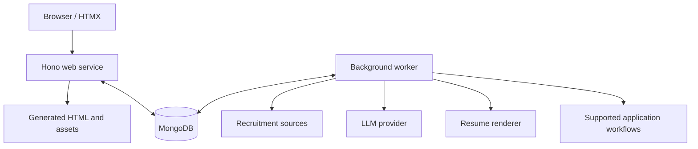
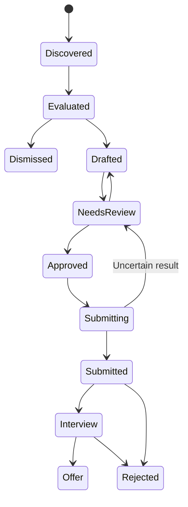

# Job Agent — Project Plan

Status: proposed · Single-user MVP · TypeScript-first

## 1. Objective

Build a personal job-search application that continuously discovers relevant vacancies across companies and regions, evaluates their fit, prepares truthful tailored resumes, assists with applications, and tracks outcomes.

Success means spending less time searching and completing repetitive forms, while increasing the number of relevant, high-quality applications and interviews.

### Target search profile

- Senior backend and developer-experience engineering roles.
- Prioritize C#, .NET runtime, Roslyn, IDE tooling, SDKs, database drivers, Go, tracing and OpenTelemetry.
- Prioritize product technology companies, particularly JetBrains, MongoDB and Datadog.
- Search France, Germany, Netherlands, Ireland, Malta, UK and other configurable regions; include suitable remote positions.
- Track relocation and visa sponsorship separately from technical fit. Unknown sponsorship is not an automatic rejection.
- Deprioritize pure DevOps/SRE and Java-centric roles.

## 2. Technology decisions

| Concern | Decision |
|---|---|
| Language | TypeScript / TSX, strict mode |
| Runtime | Node.js LTS |
| Package manager | pnpm |
| HTTP and rendering | Hono, Hono JSX, hybrid SSG + SSR |
| Interactivity | HTMX, minimal browser TypeScript |
| Styling | Tailwind CSS or plain CSS |
| Database | MongoDB, official Node.js driver |
| Scheduling | Agenda or a MongoDB-backed durable queue |
| AI | Vercel AI SDK, provider abstraction, Zod schemas |
| Browser/PDF | Playwright |
| Tests | Vitest, Testcontainers, Playwright |
| Hosting | Railway, deployment from one GitHub repository |
| CI | GitHub Actions |

Avoid a separate SPA, React client runtime, Redis, Kubernetes and unnecessary microservices. Verify dependency versions and provider integration requirements when initializing the project.

## 3. Architecture



Deploy a modular monolith with web and worker entry points. Both services share domain code and database access but can be deployed and scaled independently.

## 4. Repository structure

```text
job-agent/
  src/
    domain/
    config/
    database/
    discovery/
      providers/
    matching/
    profiles/
    resumes/
    applications/
    scheduling/
    web/
      routes/
      components/
      layouts/
      static/
    entrypoints/
      web.ts
      worker.ts
      build-static.ts
  public/
  tests/
    unit/
    integration/
    fixtures/
    e2e/
  Dockerfile
  compose.yaml
  package.json
  tsconfig.json
  .env.example
  PLAN.md
```

Use dependency injection through explicit constructors/factories. Keep provider-specific behavior out of domain objects.

## 5. Discovery

### Company registry

Store name, careers URL, ATS type, provider-specific board identifier, countries, priority, last successful sync and enabled state. Support manual registration and discovery of additional companies through permitted search sources.

### Sources

Start with public job listings from Greenhouse, Lever and Ashby. Add direct company career pages and other permitted integrations later. Use public APIs or authorized access, respect usage limits and site terms, and retain the original posting URL.

Define an adapter contract such as:

```ts
interface JobSource {
  readonly id: string;
  discover(company: Company): AsyncIterable<DiscoveredJob>;
}
```

Normalize titles, locations, remote policy, descriptions, publication dates, source identifiers, and application links. Store raw source data for debugging and traceability.

Upsert by `(source, externalId)`; detect updates using a content hash. Identify cross-source duplicates using canonical URLs and cautiously evaluated company/title/location similarities. Mark jobs closed only after a successful authoritative sync, not a failed request.

## 6. Matching

Perform inexpensive deterministic filtering before invoking an LLM. Use a structured evaluation containing:

- Technical fit, role fit, seniority fit and location fit.
- Work authorization and sponsorship status: supported, unsupported or unknown, with evidence.
- Relevant candidate achievements and missing requirements.
- Overall score, explanation, confidence and recommendation.

Version scoring rules, prompts and candidate profiles. Re-evaluate when the posting or profile changes. Store evidence from job descriptions, and distinguish facts from model inference. Treat externally sourced descriptions as untrusted data, not instructions.

Initially use rules and structured LLM responses; add embeddings or Atlas Vector Search only if they demonstrably improve retrieval.

## 7. Candidate profile and resume generation

Maintain a canonical profile of verified employment history, projects, skills, achievements, education, languages, relocation preferences and confirmed application answers.

The LLM selects and rephrases relevant facts without inventing skills, dates, metrics or experience. Reference source fact IDs in the generated resume model. Keep a versioned snapshot of the profile and job description for every generated document.

Render resume data with Hono TSX and print CSS, producing an ATS-friendly, selectable-text PDF using Playwright. Optionally generate DOCX later. Provide a preview, editable drafts, generated cover letters and PDF download.

## 8. Application workflow



Start with assisted submission: prepare documents, display the application URL, and prefill supported forms when authorized. Add automatic submission only for explicitly approved workflows and sites that permit it.

- Require confirmed answers for work authorization, sponsorship and other material screening questions.
- Pause for authentication, verification challenges, ambiguous fields or changed application forms.
- Never bypass access controls or anti-automation protections.
- Prevent duplicate applications and maintain an audit trail of exactly what was sent.
- Treat ambiguous submission outcomes as requiring reconciliation; never blindly retry a potentially successful submission.
- Prioritize personal review and referral preparation for exceptional-fit positions.

## 9. MongoDB data model

| Collection | Contents / key indexes |
|---|---|
| `companies` | Company registry; unique normalized company identifier |
| `jobs` | Normalized and raw postings; unique source + external ID; company, status, last seen |
| `searchProfiles` | Regions, priorities, filters, scoring preferences |
| `candidateProfiles` | Versioned verified candidate facts |
| `evaluations` | Job/profile/prompt versions, scores, evidence |
| `resumeDrafts` | Versioned structured drafts and document metadata |
| `applications` | Job, candidate, state, submission attempts, history; unique job + candidate |
| `syncRuns` | Provider execution history, errors, counts |
| Queue collection | Durable scheduled tasks, leases, attempts and execution history |

Use schema validation for external input and explicit TypeScript document types. Keep database indexes and schema initialization idempotent. Store PDFs in private object storage or GridFS if needed; do not rely on service-local ephemeral storage. Avoid storing binary data in unbounded documents.

## 10. Hono frontend: SSG + SSR + HTMX

Use Hono TSX components for both build-time and runtime HTML. Use `toSSG` from `hono/ssg` to generate static pages, and `disableSSG()` on runtime routes. Static generation must not connect to MongoDB, require production secrets, or emit personal data.

| Route | Rendering |
|---|---|
| `/` | SSG: generic application shell, behind authentication |
| `/about` | SSG: optional documentation |
| `/assets/*` | Static CSS and scripts |
| `/jobs` | SSR: searchable, filterable job list |
| `/jobs/:id` | SSR: job details and evaluation |
| `/companies` | SSR: company registry |
| `/applications` | SSR: application tracking |
| `/profile` | SSR: candidate profile |
| `/settings` | SSR: search preferences |
| `/fragments/*` | SSR: HTMX HTML fragments |

The SSG shell loads fresh dashboard data via HTMX after page load. Protect shell, fragments and dynamic routes consistently. For normal navigations return complete HTML pages; for HTMX requests return fragments using distinct endpoints or explicit request detection and appropriate cache headers.

```tsx
const Dashboard = () => (
  <Layout>
    <h1>Job Agent</h1>
    <section hx-get="/fragments/jobs" hx-trigger="load" hx-swap="innerHTML">
      Loading jobs…
    </section>
  </Layout>
);
```

Serve generated pages and assets from the deployment artifact with explicit route mapping, with runtime routes handling fresh data and mutations. Avoid static-file middleware shadowing authenticated or dynamic endpoints. No SPA or hydration required.

Reference: [Hono SSG](https://hono.dev/docs/helpers/ssg), [Hono JSX](https://hono.dev/docs/guides/jsx), [HTMX](https://htmx.org/docs/).

## 11. Background execution

Define durable tasks for company synchronization, job normalization/evaluation, resume generation, approved application workflows and optional outcome tracking.

- Schedule discovery several times a day with per-source concurrency and request limits.
- Deduplicate tasks using stable job keys and input versions.
- Use bounded retries with backoff for transient failures; persist terminal failures for inspection.
- Recover expired leases and gracefully shut down on deployment.
- Keep submission attempts separate from ordinary retryable tasks.
- Expose execution status and errors in the dashboard.

## 12. Railway deployment

One project with the following services:

| Service | Entry point | Connectivity |
|---|---|---|
| `web` | `start:web` | Public HTTPS endpoint, private MongoDB connection |
| `worker` | `start:worker` | Private MongoDB plus outgoing provider requests |
| `mongodb` | MongoDB service | Private network and persistent volume |

Alternatively, use MongoDB Atlas instead of the Railway database service. Configure database access, backups and network policy appropriately for the chosen deployment.

Build one Docker image with compiled TypeScript, generated HTML, and static assets. Configure service-specific startup commands. Include Playwright browser dependencies where required; optimize worker/PDF concurrency before scaling resources.

Web service binds to `0.0.0.0` and Railway's `PORT`. Use environment variables or Railway service references for secrets; never include credentials in generated HTML or source control.

Example configuration keys:

```dotenv
MONGODB_URI=
MONGODB_DATABASE=jobagent
LLM_API_KEY=
LLM_MODEL=
APP_BASE_URL=
SESSION_SECRET=
```

Provide a local Compose environment for MongoDB, plus commands to build, run web and worker, test, and generate static pages. Use Railway deployment health checks and a worker heartbeat. Define backup/export and restoration procedures before collecting important application history.

## 13. Security, privacy and observability

- Single-user authenticated dashboard; secure cookies, CSRF protection, input validation and access checks.
- Never expose MongoDB publicly without an explicit secured configuration.
- Sanitize external job HTML and prevent remote content from executing in rendered pages or PDFs.
- Use HTTPS, redact PII and tokens in logs, retain only necessary candidate data, and restrict artifact access.
- Treat LLM outputs as untrusted; validate against schemas and do not grant unrestricted tool access.
- Track sync success, discovered and matched jobs, queue depth, failures, LLM cost, application counts and interview conversion.
- Keep configurable application limits and a mechanism to pause all submission workflows.

## 14. Testing strategy

- Unit tests for normalization, deduplication, scoring, fact selection and state transitions.
- Contract tests for provider adapters using saved response fixtures.
- Integration tests with MongoDB via Testcontainers, including unique indexes, atomic updates and queue recovery.
- HTTP tests with Hono's request interface for SSR and HTMX fragments.
- SSG tests confirming no database access and no private candidate information in generated files.
- Playwright E2E tests against local mock recruitment forms; verify PDF text extraction and duplicate submission protection.
- CI runs type checking, linting, tests and image build. Never submit real applications from CI.

## 15. Implementation milestones

### M0 — Foundation

- [ ] Initialize TypeScript, pnpm, Hono TSX, HTMX and test tooling.
- [ ] Implement hybrid SSG + SSR and authentication.
- [ ] Configure MongoDB, indexes and local development environment.
- [ ] Deploy web and worker to Railway with health checks.

**Done when:** private dashboard and worker run in Railway and survive redeployment.

### M1 — Job discovery

- [ ] Add company registry and search criteria management.
- [ ] Implement Greenhouse, Lever and Ashby adapters.
- [ ] Normalize, deduplicate and persist jobs.
- [ ] Schedule sync and display status, jobs and filters.

**Done when:** new and changed jobs from configured companies appear automatically without duplicates.

### M2 — Intelligent matching

- [ ] Build versioned candidate and preference models.
- [ ] Implement deterministic filters and structured LLM evaluation.
- [ ] Display evidence, scores and sponsorship uncertainty.
- [ ] Add shortlisted/dismissed states and configurable ranking.

**Done when:** the dashboard produces an actionable shortlist with explanations.

### M3 — Resume tailoring

- [ ] Model verified professional facts and import existing CV content.
- [ ] Implement constrained resume and cover letter generation.
- [ ] Implement TSX print template and PDF renderer.
- [ ] Add draft review, editing, downloads and versioning.

**Done when:** each shortlisted vacancy can produce a reviewed, fact-grounded PDF.

### M4 — Assisted applications

- [ ] Add application state machine and confirmed answer profile.
- [ ] Implement supported application preparation/form workflows.
- [ ] Add review and approval, outcome verification and audit history.
- [ ] Test against mock forms before real use.

**Done when:** a reviewed application can be completed reliably without duplicate submission.

### M5 — Controlled automation and tracking

- [ ] Enable opt-in automatic submission for supported, permitted workflows.
- [ ] Add limits, exception handling and stop controls.
- [ ] Track replies and outcomes through authorized integrations or manual updates.
- [ ] Report interview conversion and refine ranking based on results.

**Done when:** routine applications can run under defined preferences while exceptions remain reviewable.

## 16. Non-goals for MVP

- Universal application automation for arbitrary sites.
- Scraping restricted job boards or circumventing verification systems.
- Multi-tenant SaaS, billing or public access.
- A separate vector database, SPA or distributed microservice architecture.
- Unreviewed fabricated resume content or blanket mass application campaigns.

## 17. First usable release

Deliver M0–M2 first. A continuously refreshed, ranked shortlist is valuable even before automatic applications exist. Add resume tailoring next, then application assistance. Optimize for relevant interview opportunities rather than raw application volume.
